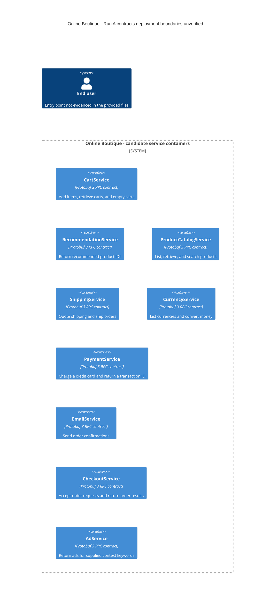

# Run A: Recovered architecture

## Agent

Codex (GPT-6).

## Files read

- `AGENTS.md` — repository instructions.
- `prompts/1-recover-architecture.md` — task instructions.
- `system/online-boutique/protos/demo.proto` — sole architecture evidence.

## Containers table

The evidence declares nine service interfaces. **[Inferred]** Each interface is shown as a candidate service container; separate runtime processes and deployment boundaries are not evidenced in the provided files. Responsibilities describe API contracts, not verified implementation behavior.

| Name | Technology/language | Responsibility | Evidence (file path and symbol) |
|---|---|---|---|
| CartService | Protobuf 3 RPC contract; implementation language not evidenced | Add items, retrieve carts, and empty carts | `system/online-boutique/protos/demo.proto`: `CartService.AddItem/GetCart/EmptyCart` |
| RecommendationService | Protobuf 3 RPC contract; implementation language not evidenced | Return recommended product IDs | `system/online-boutique/protos/demo.proto`: `RecommendationService.ListRecommendations` |
| ProductCatalogService | Protobuf 3 RPC contract; implementation language not evidenced | List, retrieve, and search products | `system/online-boutique/protos/demo.proto`: `ProductCatalogService.ListProducts/GetProduct/SearchProducts` |
| ShippingService | Protobuf 3 RPC contract; implementation language not evidenced | Quote shipping and ship orders | `system/online-boutique/protos/demo.proto`: `ShippingService.GetQuote/ShipOrder` |
| CurrencyService | Protobuf 3 RPC contract; implementation language not evidenced | List currencies and convert money | `system/online-boutique/protos/demo.proto`: `CurrencyService.GetSupportedCurrencies/Convert` |
| PaymentService | Protobuf 3 RPC contract; implementation language not evidenced | Charge a credit card and return a transaction ID | `system/online-boutique/protos/demo.proto`: `PaymentService.Charge` |
| EmailService | Protobuf 3 RPC contract; implementation language not evidenced | Send order confirmations | `system/online-boutique/protos/demo.proto`: `EmailService.SendOrderConfirmation` |
| CheckoutService | Protobuf 3 RPC contract; implementation language not evidenced | Accept order requests and return order results | `system/online-boutique/protos/demo.proto`: `CheckoutService.PlaceOrder` |
| AdService | Protobuf 3 RPC contract; implementation language not evidenced | Return ads for supplied context keywords | `system/online-boutique/protos/demo.proto`: `AdService.GetAds` |

## Dependencies table

| Caller → callee | Protocol | Evidence (file path and symbol) |
|---|---|---|

No runtime dependencies are evidenced in the provided files. RPC declarations identify operations, but no callers. Shared messages such as `CartItem`, `Money`, and `OrderResult` show schema reuse, not service calls. Actual gRPC transport, endpoints, and TLS are not evidenced in the provided files.

## Mermaid diagram

Nodes match the candidate containers above; no dependency edges are evidenced. The Person is included as required notation only; the user entry point and connection are not evidenced in the provided files.

## Gaps

All items below are **Not evidenced in the provided files**. Suggested evidence has not been opened.

| Gap | Extra evidence that would settle it |
|---|---|
| Separate deployed containers and additional services without RPC declarations | Deployment files under `system/online-boutique/kubernetes-manifests/` |
| Caller → callee dependencies and checkout orchestration | Client initialization and call sites under `system/online-boutique/src/`, including `src/checkoutservice/main.go` |
| Implementation languages and actual transport | Service source, dependency manifests, and server initialization under `system/online-boutique/src/`; `go_package` only configures generated Go bindings |
| User entry point, external systems, and their connections | Deployment definitions and relevant entry-point/provider client source |
| Data stores, persistence, and message brokers | Deployment definitions and storage or messaging client initialization; message types do not prove stores exist |
| Ports, TLS, scaling, and runtime topology | Deployment configuration and server/client initialization |

A complete runtime C4 container architecture cannot be recovered from this contract file alone.
