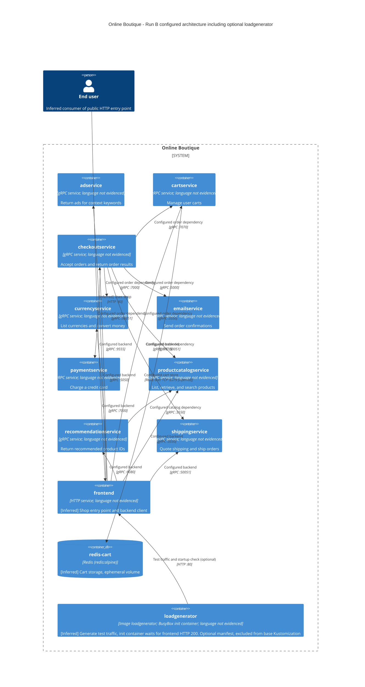

# Run B: Recovered architecture

## Agent

Codex (GPT-6).

## Files read

- `AGENTS.md`
- `prompts/1-recover-architecture.md`
- `system/online-boutique/protos/demo.proto`
- `system/online-boutique/kubernetes-manifests/adservice.yaml`
- `system/online-boutique/kubernetes-manifests/cartservice.yaml`
- `system/online-boutique/kubernetes-manifests/checkoutservice.yaml`
- `system/online-boutique/kubernetes-manifests/currencyservice.yaml`
- `system/online-boutique/kubernetes-manifests/emailservice.yaml`
- `system/online-boutique/kubernetes-manifests/frontend.yaml`
- `system/online-boutique/kubernetes-manifests/kustomization.yaml`
- `system/online-boutique/kubernetes-manifests/loadgenerator.yaml`
- `system/online-boutique/kubernetes-manifests/paymentservice.yaml`
- `system/online-boutique/kubernetes-manifests/productcatalogservice.yaml`
- `system/online-boutique/kubernetes-manifests/recommendationservice.yaml`
- `system/online-boutique/kubernetes-manifests/shippingservice.yaml`

## Containers table

This is a reconstruction of the supplied deployment configuration, not an observation of a running cluster. Implementation languages are **Not evidenced in the provided files**. Kubernetes Services and ServiceAccounts are not separate C4 containers. The loadgenerator init container is grouped into its workload at C4 level. No injected service-mesh container is established by annotations alone.

| Name | Technology/language | Responsibility | Evidence |
|---|---|---|---|
| adservice | gRPC service; language not evidenced | Return ads for context keywords | `system/online-boutique/kubernetes-manifests/adservice.yaml`: Deployment/image, Service `ports[name=grpc]`; `system/online-boutique/protos/demo.proto`: `AdService.GetAds` |
| cartservice | gRPC service; language not evidenced | Manage user carts | `system/online-boutique/kubernetes-manifests/cartservice.yaml`: Deployment/image, Service `ports[name=grpc]`; `system/online-boutique/protos/demo.proto`: `CartService.AddItem/GetCart/EmptyCart` |
| checkoutservice | gRPC service; language not evidenced | Accept orders and return order results | `system/online-boutique/kubernetes-manifests/checkoutservice.yaml`: Deployment/image, Service `ports[name=grpc]`; `system/online-boutique/protos/demo.proto`: `CheckoutService.PlaceOrder` |
| currencyservice | gRPC service; language not evidenced | List currencies and convert money | `system/online-boutique/kubernetes-manifests/currencyservice.yaml`: Deployment/image, Service `ports[name=grpc]`; `system/online-boutique/protos/demo.proto`: `CurrencyService.GetSupportedCurrencies/Convert` |
| emailservice | gRPC service; language not evidenced | Send order confirmations | `system/online-boutique/kubernetes-manifests/emailservice.yaml`: Deployment/image, Service `ports[name=grpc]`; `system/online-boutique/protos/demo.proto`: `EmailService.SendOrderConfirmation` |
| paymentservice | gRPC service; language not evidenced | Charge a credit card | `system/online-boutique/kubernetes-manifests/paymentservice.yaml`: Deployment/image, Service `ports[name=grpc]`; `system/online-boutique/protos/demo.proto`: `PaymentService.Charge` |
| productcatalogservice | gRPC service; language not evidenced | List, retrieve, and search products | `system/online-boutique/kubernetes-manifests/productcatalogservice.yaml`: Deployment/image, Service `ports[name=grpc]`; `system/online-boutique/protos/demo.proto`: `ProductCatalogService.ListProducts/GetProduct/SearchProducts` |
| recommendationservice | gRPC service; language not evidenced | Return recommended product IDs | `system/online-boutique/kubernetes-manifests/recommendationservice.yaml`: Deployment/image, Service `ports[name=grpc]`; `system/online-boutique/protos/demo.proto`: `RecommendationService.ListRecommendations` |
| shippingservice | gRPC service; language not evidenced | Quote shipping and ship orders | `system/online-boutique/kubernetes-manifests/shippingservice.yaml`: Deployment/image, Service `ports[name=grpc]`; `system/online-boutique/protos/demo.proto`: `ShippingService.GetQuote/ShipOrder` |
| frontend | HTTP service; language not evidenced | [Inferred] Shop entry point and backend client | `system/online-boutique/kubernetes-manifests/frontend.yaml`: Deployment/image, HTTP probes, `frontend-external`, backend address variables |
| redis-cart | Redis (`redis:alpine`) | [Inferred] Cart storage; ephemeral volume | `system/online-boutique/kubernetes-manifests/cartservice.yaml`: Deployment `redis-cart`, image, `/data` volume with `emptyDir`, `REDIS_ADDR` |
| loadgenerator | Image loadgenerator; BusyBox init container; language not evidenced | [Inferred] Generate test traffic; init container waits for frontend HTTP 200. Optional manifest, excluded from base Kustomization | `system/online-boutique/kubernetes-manifests/loadgenerator.yaml`: `main`, `frontend-check`, `FRONTEND_ADDR`, `USERS`, `RATE`; `system/online-boutique/kubernetes-manifests/kustomization.yaml`: commented loadgenerator resource |

## Dependencies table

Address variables evidence configured dependencies, not executed calls or specific RPC sequences. gRPC is supported by destination Service port names, gRPC probes, and the RPC interfaces in `system/online-boutique/protos/demo.proto`. Redis application protocol is [Inferred] from the image and configured endpoint. Every relationship below appears in the diagram.

| Caller → callee | Protocol | Evidence |
|---|---|---|
| frontend → productcatalogservice | gRPC :3550 | `system/online-boutique/kubernetes-manifests/frontend.yaml`: `PRODUCT_CATALOG_SERVICE_ADDR=productcatalogservice:3550`; `system/online-boutique/kubernetes-manifests/productcatalogservice.yaml`: Service `ports[name=grpc]` and gRPC probes |
| frontend → currencyservice | gRPC :7000 | `system/online-boutique/kubernetes-manifests/frontend.yaml`: `CURRENCY_SERVICE_ADDR=currencyservice:7000`; `system/online-boutique/kubernetes-manifests/currencyservice.yaml`: Service `ports[name=grpc]` and gRPC probes |
| frontend → cartservice | gRPC :7070 | `system/online-boutique/kubernetes-manifests/frontend.yaml`: `CART_SERVICE_ADDR=cartservice:7070`; `system/online-boutique/kubernetes-manifests/cartservice.yaml`: Service `ports[name=grpc]` and gRPC probes |
| frontend → recommendationservice | gRPC :8080 | `system/online-boutique/kubernetes-manifests/frontend.yaml`: `RECOMMENDATION_SERVICE_ADDR=recommendationservice:8080`; `system/online-boutique/kubernetes-manifests/recommendationservice.yaml`: Service `ports[name=grpc]` and gRPC probes |
| frontend → shippingservice | gRPC :50051 | `system/online-boutique/kubernetes-manifests/frontend.yaml`: `SHIPPING_SERVICE_ADDR=shippingservice:50051`; `system/online-boutique/kubernetes-manifests/shippingservice.yaml`: Service `ports[name=grpc]` and gRPC probes |
| frontend → checkoutservice | gRPC :5050 | `system/online-boutique/kubernetes-manifests/frontend.yaml`: `CHECKOUT_SERVICE_ADDR=checkoutservice:5050`; `system/online-boutique/kubernetes-manifests/checkoutservice.yaml`: Service `ports[name=grpc]` and gRPC probes |
| frontend → adservice | gRPC :9555 | `system/online-boutique/kubernetes-manifests/frontend.yaml`: `AD_SERVICE_ADDR=adservice:9555`; `system/online-boutique/kubernetes-manifests/adservice.yaml`: Service `ports[name=grpc]` and gRPC probes |
| checkoutservice → productcatalogservice | gRPC :3550 | `system/online-boutique/kubernetes-manifests/checkoutservice.yaml`: `PRODUCT_CATALOG_SERVICE_ADDR=productcatalogservice:3550`; `system/online-boutique/kubernetes-manifests/productcatalogservice.yaml`: Service `ports[name=grpc]` and gRPC probes |
| checkoutservice → shippingservice | gRPC :50051 | `system/online-boutique/kubernetes-manifests/checkoutservice.yaml`: `SHIPPING_SERVICE_ADDR=shippingservice:50051`; `system/online-boutique/kubernetes-manifests/shippingservice.yaml`: Service `ports[name=grpc]` and gRPC probes |
| checkoutservice → paymentservice | gRPC :50051 | `system/online-boutique/kubernetes-manifests/checkoutservice.yaml`: `PAYMENT_SERVICE_ADDR=paymentservice:50051`; `system/online-boutique/kubernetes-manifests/paymentservice.yaml`: Service `ports[name=grpc]` and gRPC probes |
| checkoutservice → emailservice | gRPC :5000 | `system/online-boutique/kubernetes-manifests/checkoutservice.yaml`: `EMAIL_SERVICE_ADDR=emailservice:5000`; `system/online-boutique/kubernetes-manifests/emailservice.yaml`: Service `ports[name=grpc]` and gRPC probes |
| checkoutservice → currencyservice | gRPC :7000 | `system/online-boutique/kubernetes-manifests/checkoutservice.yaml`: `CURRENCY_SERVICE_ADDR=currencyservice:7000`; `system/online-boutique/kubernetes-manifests/currencyservice.yaml`: Service `ports[name=grpc]` and gRPC probes |
| checkoutservice → cartservice | gRPC :7070 | `system/online-boutique/kubernetes-manifests/checkoutservice.yaml`: `CART_SERVICE_ADDR=cartservice:7070`; `system/online-boutique/kubernetes-manifests/cartservice.yaml`: Service `ports[name=grpc]` and gRPC probes |
| recommendationservice → productcatalogservice | gRPC :3550 | `system/online-boutique/kubernetes-manifests/recommendationservice.yaml`: `PRODUCT_CATALOG_SERVICE_ADDR=productcatalogservice:3550`; `system/online-boutique/kubernetes-manifests/productcatalogservice.yaml`: Service `ports[name=grpc]` and gRPC probes |
| cartservice → redis-cart | Redis over TCP :6379 [Inferred] | `system/online-boutique/kubernetes-manifests/cartservice.yaml`: `REDIS_ADDR=redis-cart:6379`, Redis image, Service `tcp-redis` |
| loadgenerator → frontend | HTTP :80 | `system/online-boutique/kubernetes-manifests/loadgenerator.yaml`: `FRONTEND_ADDR=frontend:80` on main and init; init `wget http://${FRONTEND_ADDR}`; main traffic use is [Inferred] |
| user → frontend | HTTP :80 | `system/online-boutique/kubernetes-manifests/frontend.yaml`: `frontend-external` LoadBalancer, `ports[name=http]` 80 → 8080, HTTP probes; human use is [Inferred] |

The email endpoint is consistent: checkout uses Service port 5000, which maps to emailservice container port 8080 (`emailservice.yaml`: Service `port/targetPort`, Deployment `PORT`).

## Mermaid diagram

## Gaps

| Gap or caveat | Evidence and extra file needed |
|---|---|
| Unresolved shopping assistant reference | `system/online-boutique/kubernetes-manifests/frontend.yaml` sets `SHOPPING_ASSISTANT_SERVICE_ADDR=shoppingassistantservice:80`, but no supplied Deployment or Service defines it. `ENABLE_ASSISTANT` is commented out; actual enablement and runtime calls are **Not evidenced in the provided files**. No running container/edge is asserted in the diagram. Frontend feature-gating/client source and an assistant deployment manifest would settle this. |
| Optional loadgenerator | `system/online-boutique/kubernetes-manifests/kustomization.yaml` comments out `loadgenerator.yaml`; its diagram node and relationship apply only when separately included. The comment refers to a development module in `skaffold.yaml`; that file would establish the development setup. |
| Runtime calls and exact orchestration | Environment variables cannot prove every configured backend is called, or establish order, retries, or RPC selection. Inspect service client setup and call sites, including `system/online-boutique/src/checkoutservice/main.go` and frontend source. |
| Implementation languages | Image names, RPC schemas, and `go_package` do not establish server languages. Inspect service Dockerfiles, dependency manifests, and entry points under `system/online-boutique/src/`. |
| External providers and additional stores | Payment, email, shipping providers, queues, and other stores are **Not evidenced in the provided files**. Inspect corresponding implementation/client configuration; no external systems are added based on service names. |
| Redis durability | `system/online-boutique/kubernetes-manifests/cartservice.yaml` mounts `/data` from `emptyDir`, so this manifest provides no persistent volume. Actual cart key structure, expiration, and Redis persistence settings require cart storage source and runtime Redis configuration. |
| Production topology and transport security | Live deployment, overlays, image contents, actual replica counts, TLS, and mesh injection are **Not evidenced in the provided files** beyond explicit manifest settings. Inspect applied overlays, image build files, server/client setup, and cluster state. |

No files suggested in Gaps were opened.
